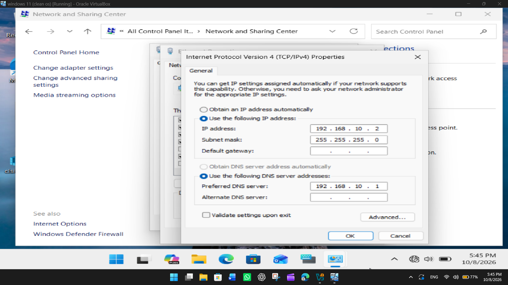

# Windows Server Active Directory Home Lab

## 📌 Project Overview
This project details the step-by-step deployment of a hands-on Active Directory (AD) environment built entirely within **Oracle VirtualBox**. Following foundational industry practices, I deployed a Windows Server instance, promoted it to a Domain Controller (`lab.local`), established a department-focused organizational hierarchy with a branch, users and groups, successfully integrated a Windows client workstation into the domain, and implemented delegation controls.

## 🛠️ Environment & Tools
* **Hypervisor:** VirtualBox
* **Domain Controller OS:** Windows Server 2022 Standard Evaluation
* **Client OS:** Windows 11 Pro 
* **Core Services:** Active Directory Domain Services (AD DS), DNS, Group Policy Management

---

## Phase 1: Environment Setup & Network Configuration
In this phase, I configured the virtual network adapter settings inside VirtualBox to allow internal host communication and set up static routing on the client side so it could locate the Domain Controller.

### Network & DNS Realignment
Before joining the domain, the client machine's network adapter settings were modified to use a static IP (`192.168.10.2`) and pointed to the Domain Controller's IP address (`192.168.10.1`) as its primary DNS server.

---

## 🌲 Phase 2: Domain Architecture & Directory Setup
*(Note: This phase covers the promotion of the server to a Domain Controller and the creation of the `lab.local` forest.)*

---

## 👥 Phase 3: Organizational Units (OUs), Groups, and Users
To mimic a production enterprise infrastructure, I built a logical structure inside **Active Directory Users and Computers (ADUC)** to manage corporate assets and user lifecycle efficiently.

### Directory Structure & Hierarchy
I created an Organizational Unit (OU) structure starting with a top-level `Branches` folder, followed by a regional location (`Houston`), which branches further into targeted sub-OUs for asset and user organization (`Laptop`, `Workstation`, `Users`).

### Security Groups & User Provisioning
To manage access control effectively, I deployed three functional departmental Security Groups: `Accounting`, `Helpdesk`, and `ITSupport`. Individual employee accounts, such as `Alice Johnson`, were provisioned and mapped explicitly into their corresponding business groups.

---

## 🔐 Phase 4: Client Integration, Delegation & Access Control
The final phase validates the lab deployment by authenticating network access, applying systems policies, and structuring administrative permissions.

### Domain Join Verification
After aligning the network settings, the Windows client machine (`aariq`) successfully joined the `lab.local` domain. The machine computer object automatically populated inside the designated directory path on the Domain Controller.

### Systems Policy Management
I explored the **Group Policy Management Console (GPMC)** to audit administrative guardrails and default security configurations, reviewing domain-wide password rules such as the Maximum Password Age settings.

### Administrative Delegation of Control
To practice the security principle of **least privilege**, I ran the Delegation of Control Wizard. This assigned specific elevated operational tasks (such as resetting user passwords) directly to the `Helpdesk` security group without explicitly adding them to the global Domain Admins group.

